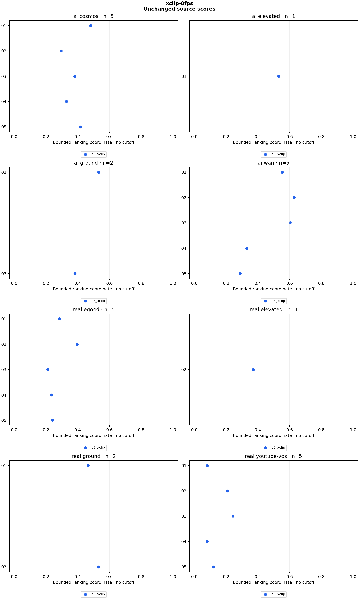

# xclip-8fps

26 clips, 26 scores. Sampling: `centered_2s_8fps`.

Higher ranking coordinates mean more AI-like within each detector. There is no decision cutoff, probability, error-rate claim or model-agreement verdict. AUC counts AI/real pair orderings, with ties worth half. Source clusters and repeated scenes make pairs dependent; these counts are descriptive.

| Detector | Variant | AI clips | Real clips | AI above real pairs | Tied pairs | Pairs | AUC |
|---|---|---:|---:|---:|---:|---:|---:|
| d3_xclip | original | 13 | 13 | 143 | 0 | 169 | 0.846154 |

## Raw scores

| Clip | Label | Detector | Variant | Raw temporal std (higher = real-like) | Bounded ranking coordinate |
|---|---|---|---|---:|---:|
| panel_ego4d_01 | real | d3_xclip | original | 2.516393 | 0.284382 |
| panel_ego4d_02 | real | d3_xclip | original | 1.521853 | 0.396534 |
| panel_ego4d_03 | real | d3_xclip | original | 3.736547 | 0.211124 |
| panel_ego4d_04 | real | d3_xclip | original | 3.282490 | 0.233509 |
| panel_ego4d_05 | real | d3_xclip | original | 3.161180 | 0.240316 |
| panel_youtube_vos_01 | real | d3_xclip | original | 11.177776 | 0.082117 |
| panel_youtube_vos_02 | real | d3_xclip | original | 3.830377 | 0.207023 |
| panel_youtube_vos_03 | real | d3_xclip | original | 3.120513 | 0.242688 |
| panel_youtube_vos_04 | real | d3_xclip | original | 11.333067 | 0.081083 |
| panel_youtube_vos_05 | real | d3_xclip | original | 7.385302 | 0.119256 |
| panel_cosmos_01 | ai | d3_xclip | original | 1.079571 | 0.480868 |
| panel_cosmos_02 | ai | d3_xclip | original | 2.381735 | 0.295706 |
| panel_cosmos_03 | ai | d3_xclip | original | 1.619965 | 0.381684 |
| panel_cosmos_04 | ai | d3_xclip | original | 2.040210 | 0.328925 |
| panel_cosmos_05 | ai | d3_xclip | original | 1.401963 | 0.416326 |
| panel_wan_01 | ai | d3_xclip | original | 0.803485 | 0.554482 |
| panel_wan_02 | ai | d3_xclip | original | 0.592457 | 0.627960 |
| panel_wan_03 | ai | d3_xclip | original | 0.657605 | 0.603280 |
| panel_wan_04 | ai | d3_xclip | original | 2.021849 | 0.330923 |
| panel_wan_05 | ai | d3_xclip | original | 2.454504 | 0.289477 |
| construction_real_01 | real | d3_xclip | original | 1.148134 | 0.465520 |
| construction_real_02 | real | d3_xclip | original | 1.691037 | 0.371604 |
| construction_ai_01 | ai | d3_xclip | original | 0.884863 | 0.530543 |
| construction_ai_02 | ai | d3_xclip | original | 0.882211 | 0.531290 |
| construction_ai_03 | ai | d3_xclip | original | 1.610849 | 0.383017 |
| construction_real_03 | real | d3_xclip | original | 0.884828 | 0.530552 |

## Method

**d3_xclip:** Author BGR order; trim 10% from each end of long axis; linear 224×224 resize; ImageNet normalization; microsoft/xclip-base-patch16 vision pooler with native num_frames=8, all 16 frames passed together (two groups of eight); sample std of second differences of L2 frame-feature distances. Lower discrepancy is more AI-like; ai_score=1/(1+temporal_std) is ranking only, not a probability or midpoint decision.

D3 XCLIP-16 branch with the pinned microsoft/xclip-base-patch16 checkpoint (native num_frames=8, 16 inputs form two eight-frame groups). Same 26 previously examined sources and sampling as temporal-8fps. No calibration or threshold decision. Preserve author BGR preprocessing, L2 discrepancy and sample standard deviation. Direct source decoding and centered windows differ from upstream random-window JPEG extraction. See configs/xclip-ranking-policy.md. A feature encoder comparison, not a new holdout or full paper reproduction.

Reproduce: `uv run python run.py experiment configs/experiments/xclip-8fps.json`.

[Scores and temporal distances](scores.csv) · [Rank counts](summary.json) · [Provenance](run.json) · [Checks](validation.json)
