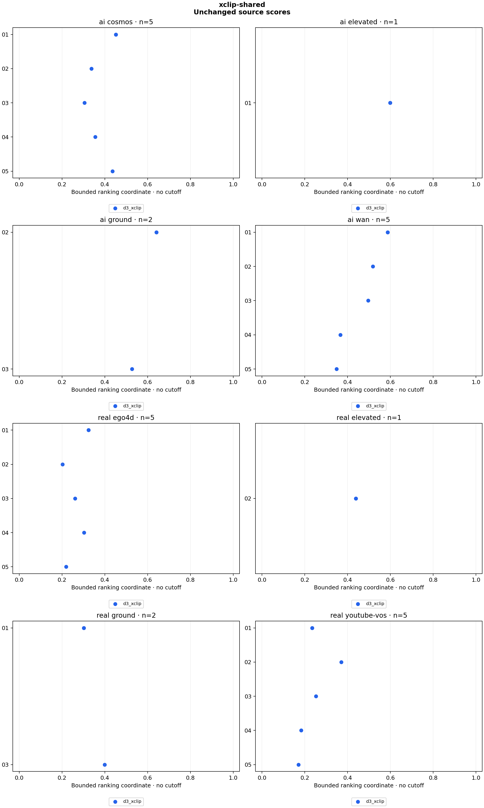

# xclip-shared

26 clips, 26 scores. Sampling: `centered_4s_16`.

Higher ranking coordinates mean more AI-like within each detector. There is no decision cutoff, probability, error-rate claim or model-agreement verdict. AUC counts AI/real pair orderings, with ties worth half. Source clusters and repeated scenes make pairs dependent; these counts are descriptive.

| Detector | Variant | AI clips | Real clips | AI above real pairs | Tied pairs | Pairs | AUC |
|---|---|---:|---:|---:|---:|---:|---:|
| d3_xclip | original | 13 | 13 | 152 | 0 | 169 | 0.899408 |

## Raw scores

| Clip | Label | Detector | Variant | Raw temporal std (higher = real-like) | Bounded ranking coordinate |
|---|---|---|---|---:|---:|
| panel_ego4d_01 | real | d3_xclip | original | 2.086823 | 0.323958 |
| panel_ego4d_02 | real | d3_xclip | original | 3.943310 | 0.202294 |
| panel_ego4d_03 | real | d3_xclip | original | 2.831897 | 0.260967 |
| panel_ego4d_04 | real | d3_xclip | original | 2.297542 | 0.303256 |
| panel_ego4d_05 | real | d3_xclip | original | 3.569993 | 0.218819 |
| panel_youtube_vos_01 | real | d3_xclip | original | 3.259449 | 0.234772 |
| panel_youtube_vos_02 | real | d3_xclip | original | 1.699885 | 0.370386 |
| panel_youtube_vos_03 | real | d3_xclip | original | 2.953146 | 0.252963 |
| panel_youtube_vos_04 | real | d3_xclip | original | 4.458431 | 0.183203 |
| panel_youtube_vos_05 | real | d3_xclip | original | 4.863893 | 0.170535 |
| panel_cosmos_01 | ai | d3_xclip | original | 1.214800 | 0.451508 |
| panel_cosmos_02 | ai | d3_xclip | original | 1.964721 | 0.337300 |
| panel_cosmos_03 | ai | d3_xclip | original | 2.273442 | 0.305489 |
| panel_cosmos_04 | ai | d3_xclip | original | 1.810221 | 0.355844 |
| panel_cosmos_05 | ai | d3_xclip | original | 1.295522 | 0.435631 |
| panel_wan_01 | ai | d3_xclip | original | 0.702532 | 0.587361 |
| panel_wan_02 | ai | d3_xclip | original | 0.926877 | 0.518975 |
| panel_wan_03 | ai | d3_xclip | original | 1.016060 | 0.496017 |
| panel_wan_04 | ai | d3_xclip | original | 1.727130 | 0.366686 |
| panel_wan_05 | ai | d3_xclip | original | 1.863069 | 0.349276 |
| construction_real_01 | real | d3_xclip | original | 2.310011 | 0.302114 |
| construction_real_02 | real | d3_xclip | original | 1.276101 | 0.439348 |
| construction_ai_01 | ai | d3_xclip | original | 0.669686 | 0.598915 |
| construction_ai_02 | ai | d3_xclip | original | 0.558232 | 0.641753 |
| construction_ai_03 | ai | d3_xclip | original | 0.898015 | 0.526866 |
| construction_real_03 | real | d3_xclip | original | 1.505897 | 0.399059 |

## Method

**d3_xclip:** Author BGR order; trim 10% from each end of long axis; linear 224×224 resize; ImageNet normalization; microsoft/xclip-base-patch16 vision pooler with native num_frames=8, all 16 frames passed together (two groups of eight); sample std of second differences of L2 frame-feature distances. Lower discrepancy is more AI-like; ai_score=1/(1+temporal_std) is ranking only, not a probability or midpoint decision.

D3 XCLIP-16 branch with the pinned microsoft/xclip-base-patch16 checkpoint (native num_frames=8, 16 inputs form two eight-frame groups). Same 26 previously examined sources and sampling as temporal-shared. No calibration or threshold decision. Preserve author BGR preprocessing, L2 discrepancy and sample standard deviation. Direct source decoding and centered windows differ from upstream random-window JPEG extraction. See configs/xclip-ranking-policy.md. A feature encoder comparison, not a new holdout or full paper reproduction.

Reproduce: `uv run python run.py experiment configs/experiments/xclip-shared.json`.

[Scores and temporal distances](scores.csv) · [Rank counts](summary.json) · [Provenance](run.json) · [Checks](validation.json)
