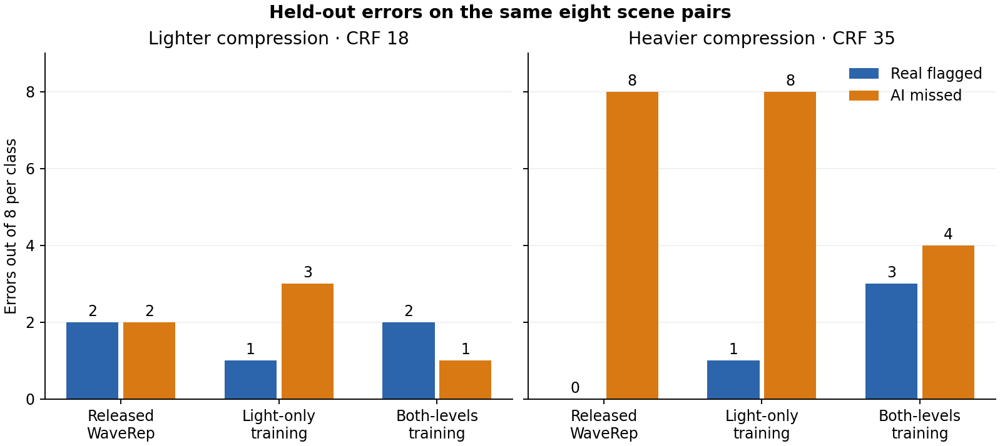

# Training with compression recovered some misses

On eight fresh scene pairs, the head trained at both compression levels
caught **4/8** heavily compressed AI clips. Released WaveRep and the head
trained only at CRF 18 caught **0/8**. The new head also wrongly flagged
**3/8** real clips, so it did not meet the rule for an upgrade.

| Head | CRF 18: real flagged | CRF 18: AI missed | CRF 35: real flagged | CRF 35: AI missed |
|---|---:|---:|---:|---:|
| Released WaveRep | 2/8 | 2/8 | 0/8 | 8/8 |
| Trained on CRF 18 | 1/8 | 3/8 | 1/8 | 8/8 |
| Trained on CRF 18 and 35 | 2/8 | 1/8 | 3/8 | 4/8 |

The two-level head also ranked AI above real in **44/64** comparisons at
CRF 35, versus **40/64** for light-only training and **31/64** for the
released head. All three ranked **55/64** at CRF 18. These comparisons
share clips and do not measure general accuracy.

## What changed

We kept WaveRep's encoder fixed and fitted two linear heads on 18 real
and 18 generated development clips. The first saw one encode per clip;
the second saw two. Both use the average of 16 frame features, normalized
to unit length, and the same ridge penalty. Decisions use a margin of zero,
with no cutoff search. A margin is not a confidence percentage.

The [selection and training rule](../../configs/linear-head-selection.md)
was fixed before training. Both fitted heads were locked in
`684b66c` before test inference. The test set contains four LTX and four
Kling v3 scene pairs with different original recordings and hashes from
training. All inputs share 504 × 504 resolution, 24 fps and four seconds.
This is a small same-dataset test; transfer to other sources and generators
remains untested.

## Checks

The captured encoder features reconstructed the released frame logits
exactly. The released scores and input hashes also matched all 32
overlapping cases from the earlier format study. Independent checks
verified the 32 test encodes, 96 margins, and both error directions.
Weights and videos stay local.

The demo stays unchanged. The [cutoff follow-up](../head-cutoff/report.md)
repeated the four compressed AI catches at margin zero on fresh footage,
but a stricter rule lost them. A next training round should add diverse
compressed real footage and use separate development recordings for
choosing any cutoff.

[Training record](fit.json) · [Test margins](scores.csv) ·
[Exact counts](summary.json) ·
[Reproduce](../../docs/experiments.md#train-a-small-head-on-both-compression-levels)
